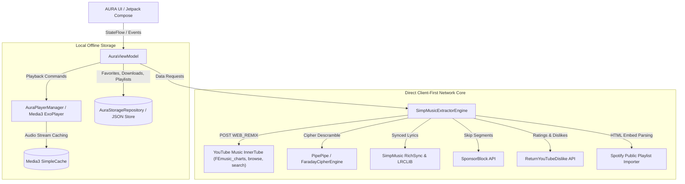

<div align="center">


# Aura

### Next-Generation FOSS YouTube Music Client for Android
Built with **100% Native Kotlin**, **Jetpack Compose (Material 3)**, **AndroidX Media3 (ExoPlayer)**, and an ultra-fast, direct **Client-First InnerTube & PipePipe Extraction Engine**.

<br/>

[-3DDC84.svg?style=for-the-badge&logo=android&logoColor=white)](https://android.com)
[](https://kotlinlang.org)
[](https://developer.android.com/jetpack/compose)
[](https://developer.android.com/guide/topics/media/media3)
[](LICENSE)
[]()
[]()

<br/>

<p align="center">
  <a href="https://github.com/topics/android"></a>
  <a href="https://github.com/topics/kotlin"></a>
  <a href="https://github.com/topics/jetpack-compose"></a>
  <a href="https://github.com/topics/media3"></a>
  <a href="https://github.com/topics/exoplayer"></a>
  <a href="https://github.com/topics/youtube-music"></a>
  <a href="https://github.com/topics/innertube"></a>
  <a href="https://github.com/topics/simpmusic"></a>
  <a href="https://github.com/topics/lyrics"></a>
  <a href="https://github.com/topics/sponsorblock"></a>
  <a href="https://github.com/topics/material-3"></a>
  <a href="https://github.com/topics/foss"></a>
  <a href="https://github.com/topics/music-player"></a>
</p>

[Features](#features) • [Credits & Inspiration](#credits--inspiration) • [Architecture](#architecture--data-flow) • [User Interface](#user-interface) • [Audio & Fidelity](#audio--equalizer-fidelity) • [Privacy](#privacy-manifesto) • [Build & Install](#building--installation) • [Legal Disclaimer](#legal-disclaimer--terms-of-use)

</div>

---

### Repository Tags
`android` `kotlin` `jetpack-compose` `material3` `media3` `exoplayer` `youtube-music` `innertube` `simpmusic` `pipepipe` `synced-lyrics` `karaoke` `sponsorblock` `return-youtube-dislike` `equalizer` `offline-playback` `foss` `client-first`

---

> [!NOTE]
> **Aura** is an independent, 100% free and open-source (FOSS) client-first YouTube Music experience. Designed from the ground up with **Warm Obsidian Glassmorphism**, dynamic album art palette color adaptation, word-by-word karaoke synchronized lyrics, integrated SponsorBlock, and dual customizable player styles (Spotify Encore & Blur Liquid Glass).

---

## Credits & Inspiration

Aura stands on the shoulders of the extraordinary open-source community. We proudly credit and extend our deepest gratitude to the following pioneering repositories:

* **<a href="https://github.com/maxrave-dev/SimpMusic" target="_blank">SimpMusic (by maxrave-dev)</a>** — The foundational inspiration and architectural gold standard for our native client-side extraction, Media3 `ResolvingDataSource` + `SimpleCache` disk caching, 10-band equalizer DSP curves, RichSync synchronized lyrics integration, and SponsorBlock automation.
* **<a href="https://github.com/z-huang/InnerTune" target="_blank">InnerTune (by z-huang)</a>** — The groundbreaking pioneer project that originated direct client-side exploration of YouTube Music's InnerTube API.
* **<a href="https://github.com/TeamNewPipe/NewPipeExtractor" target="_blank">NewPipeExtractor & PipePipe</a>** — The battle-tested streaming URL resolver and signature cipher descrambler that powers seamless audio stream extraction.
* **<a href="https://sponsor.ajay.app/" target="_blank">SponsorBlock</a>** — Community-driven database allowing automated skipping of sponsors, channel intros, non-music banter, and outro credits.
* **<a href="https://returnyoutubedislike.com/" target="_blank">Return YouTube Dislike</a>** — Public API restoring transparent community vote ratios and rating metrics.
* **<a href="https://lrclib.net/" target="_blank">LRCLIB</a>** — Free and open synchronized line-by-line lyrics engine.
* **<a href="https://github.com/yuliskov/SmartTube" target="_blank">SmartTube (by yuliskov)</a>** — Outstanding inspiration for YouTube cipher descrambling and high-res video/audio streaming.

---

## Features

### 1. Pure Audio & High-Fidelity Playback
- **100% Client-First Architecture**: Connects directly to YouTube Music's `WEB_REMIX` InnerTube endpoints. No intermediate servers, no API proxy delays, and zero tracking.
- **High-Bitrate Direct Streaming**: Unlocks direct Opus / AAC streams up to 256kbps for crisp acoustic clarity.
- **Background Playback & Lockscreen Notification**: Full Android MediaSession integration with playback state, scrub controls, artwork display, and seamless headset buttons.
- **Intelligent Stream Pre-Fetching & Caching**: Employs an LRU Media3 `SimpleCache` to preload the next track in the queue, ensuring instant zero-latency transitions.
- **Studio Audio Auto-Resolver**: Intelligently identifies tracks with conversational movie skits, intro dialogues, or music video cuts and automatically prioritizes the clean official studio audio recording.

### 2. Dual Signature Now Playing Player Styles
- **Spotify Encore Style**:
  - Full-screen album art with tactile gesture scrubbing.
  - Floating controls with shuffle, loop, and instant queue reordering.
  - Dynamic harmonic glow derived in real-time from album cover artwork.
- **Blur - Liquid Glass Style**:
  - Apple Music-inspired ultra-high blur glass backdrop (`RenderEffect` / `saturate`).
  - Elevated album artwork with frosted interactive control capsule.
  - Non-overlapping bottom section ensuring complete visual ergonomics.

### 3. RichSync Live Synced & Karaoke Lyrics
- **Real-Time Synchronized Lyrics**: Powered by SimpMusic RichSync and LRCLIB with line-by-line automated scrolling.
- **Word-by-Word Apple Music-Style Karaoke**: Glowing active words synced with audio timestamps for sing-along sessions.
- **Dynamic Cover Art Palette Adaptation**: The lyrics background dynamically extracts the dominant hue from the album art and applies intelligent contrast tuning (leaning into deep, rich tones so white text remains 100% legible).
- **Fullscreen Immersive Lyrics**: Expand lyrics to full screen with customized solid background tinted to the track's color profile and matched control bars.
- **Romanization Engine**: Transliterates Japanese (Kanji/Kana), Korean (Hangul), and Chinese (Hanzi) lyrics to Latin alphabet on the fly.
- **Fine-Grained Timing Offset**: Adjust lyrics timing from `-5.0s` to `+5.0s` in 100ms increments to achieve pitch-perfect synchronization.

### 4. 10-Band Graphic Equalizer
- **10-Band Hardware Curve DSP**: Adjustable frequencies (31Hz, 62Hz, 125Hz, 250Hz, 500Hz, 1kHz, 2kHz, 4kHz, 8kHz, 16kHz) with `-12dB` to `+12dB` range.
- **Curated Acoustic Presets**:
  - *Balanced Sound* — Natural and transparent audio profile.
  - *Bass Booster* — Deep, punchy low-end response.
  - *Vocal Booster* — Enhanced speech clarity and crisp mids.
  - *Treble Booster* — Airy and detailed acoustic highs.
  - *Studio Reference* — Flat uncolored reproduction for studio monitors.
  - *Late Night Lounge* — Compressed dynamics for quiet nocturnal listening.

### 5. Intelligent Automation & Safety
- **SponsorBlock Integration**: Automatically skips intros, sponsor endorsements, self-promotions, interaction reminders, and non-music interludes.
- **Return YouTube Dislike**: Displays real-time like/dislike counts and community approval ratings.
- **Sleep Timer**: Configurable countdown (15m, 30m, 45m, 60m, or end-of-track) with smooth audio volume fade-out.

### 6. Ergonomic UI & Navigation
- **Floating Dynamic Capsule Dock**: Smoothly animating capsule menu bar with spring physics that expands active tab text labels and compresses inactive icons.
- **Floating Overlaid Mini-Player**: Detached mini-player hovering above the interface with a proportional circle-fill play button, high-contrast skip icons, and live progress indicator.
- **Dynamic Greeting Header**: Context-aware greeting (`Good morning`, `Good afternoon`, `Good evening`) welcoming you upon launch.
- **Dynamic Query Filter Pills**: Effortlessly filter feeds by `All`, `New Release`, `Trending`, `Top Chart`, and `Podcasts`.
- **Top Artists Carousel & Dedicated Profile Screen**:
  - Live YouTube Music Charts (`FEmusic_charts`) integration.
  - Tapping an artist opens a dedicated profile with a full-bleed widescreen banner, subscriber count aligned bottom-right, and ranked 1–10 popular songs with stream counts.
  - Vertical 3-dot options menu for every song (*Play Next, Add to Queue, Liked Songs, Add to Playlist*).
- **Community Playlists Carousel & Dedicated Playlist Screen**:
  - Live public playlists uploaded by the YouTube Music community (`EgeKAQQoAEABahIQBBAKEAUQDhADEAkQFRAQEBE%3D`).
  - Full playlist view featuring top banner artwork, title & author/views (e.g. `29M views • 100 tracks`), and complete ranked song list with duration and 3-dot bottom sheet actions.

### 7. Direct Client-Side Spotify Playlist Importer
- **Zero-Server Playlist Conversion**: Simply paste any public Spotify playlist URL (`https://open.spotify.com/playlist/...`).
- **Parallel Resolution**: The app parses Spotify's embed schema directly on your device, resolves high-res covers, and queries matching YouTube Music streams in parallel without needing a backend server or Spotify API credentials.

### 8. Offline-First Library & Cache
- **1-Tap Offline Downloads**: Cache audio streams, metadata, and lyrics directly to device storage for true airplane-mode playback.
- **Favorites & Custom Playlists**: Organize liked tracks and create local playlists with custom covers and descriptions.
- **Stream Cache Management**: 1-tap cache cleaner in Settings to purge temporary media buffers and keep storage lean.

---

## Architecture & Data Flow

AURA Music is built on the **Clean Architecture & MVVM** paradigm using 100% native Kotlin and Jetpack Compose.



---

## User Interface

AURA Music features an Obsidian Dark visual language designed natively with Jetpack Compose:

| Interface Component | Overview | Capabilities |
| :--- | :--- | :--- |
| **Dynamic Home Feed** | Contextual greeting header, active category query filter pills, and live YouTube Music charts | Zero-lag pagination, slidable mood capsules |
| **Top Artists Profile** | Full-bleed widescreen artist banner with subscriber count aligned bottom-right | Ranked 1-10 popular songs, streams counter, 3-dot options sheet |
| **Community Playlists** | Public playlists uploaded by users on YouTube Music | Complete tracklist resolution with author, views, duration, and cover art |
| **Spotify Encore Player** | Full-bleed album art with dynamic harmonic glow backdrop | Tactile gesture scrubbing, loop, shuffle, live queue reordering |
| **Blur Liquid Glass Player** | Apple Music-inspired glassmorphism with elevated artwork | High-blur backdrop, frosted interactive control capsule |
| **RichSync Synced Lyrics** | Line-by-line auto-scrolling with word-by-word karaoke glow | Adaptive dark-contrast background, fine-tune timing offset (-5s to +5s) |
| **10-Band Graphic Equalizer** | DSP hardware curve frequency tuning with acoustic presets | Real-time audio band response, preamp gain control |
| **Spotify Public Importer** | Instant client-side conversion of public Spotify playlist links | Parallel track resolution, zero server dependency |
| **Offline Library** | Local downloads, favorites, and custom playlist curation | Airplane-mode playback, persistent disk caching |

---

## Audio & Equalizer Fidelity

AURA Music implements a custom audio pipeline operating directly on top of AndroidX Media3:

```text
[ Audio Source (Opus / AAC 256kbps) ]
                 ↓
     [ Media3 SimpleCache ]
                 ↓
     [ ExoPlayer Audio Engine ]
                 ↓
   [ EqualizerAudioProcessor (10-Band) ]
   ┌───────────────────────────────────┐
   │ 31Hz  62Hz  125Hz 250Hz 500Hz     │
   │ 1kHz  2kHz  4kHz  8kHz  16kHz     │
   └───────────────────────────────────┘
                 ↓
     [ Preamp Dynamic Limiter ]
                 ↓
      [ Android AudioTrack HAL ]
```

---

## Privacy Manifesto

AURA Music takes user privacy as an absolute invariant:
- **Zero Ads**: No promotional popups, no sponsored banners, no audio advertisements.
- **Zero Analytics / Telemetry**: No Firebase Analytics, no Google Analytics, no tracking SDKs.
- **Zero Third-Party User Accounts**: No forced login, no email required, no sign-in walls.
- **Zero Remote Proxy Servers**: Your queries go directly from your device to the content sources.
- **Local Storage Only**: Your playback history, liked tracks, playlists, and offline downloads are stored exclusively on your physical phone storage.

---

## Building & Installation

### Prerequisites
* **Android Studio** Ladybug (2024.2+) or Meerkat (2024.3+)
* **JDK 17** or **JDK 21**
* **Android SDK**: `compileSdk = 35`, `minSdk = 26`, `targetSdk = 35`

### 1. Clone the Repository
```bash
git clone https://github.com/your-username/aura-android-kotlin.git
cd aura-android-kotlin
```

### 2. Build Debug APK
On Windows (PowerShell):
```powershell
.\gradlew.bat assembleDebug
```
On Linux / macOS:
```bash
./gradlew assembleDebug
```

The compiled APK will be located at:
`app/build/outputs/apk/debug/app-debug.apk`

### 3. Install on Connected Device
```bash
adb install -r app/build/outputs/apk/debug/app-debug.apk
adb shell am start -n com.auramusic.kotlin/com.auramusic.app.MainActivity
```

---

## Legal Disclaimer & Terms of Use

### 1. 100% Free, Open-Source & Strictly Non-Commercial
AURA Music is a free and open-source project (FOSS) developed strictly for educational and personal use. **This application is never sold, nor is it monetized in any form.** There are no paywalls, subscriptions, in-app purchases, advertisements, or commercial interests behind this project.

### 2. Custom Content Filtering Client
AURA Music functions strictly as a customized, third-party client and specialized media browser. It parses publicly accessible endpoints of YouTube and YouTube Music, rendering them within a native user interface. Providing an ad-free viewing experience is functionally identical to using a standard web browser (such as Brave, Chrome, or Firefox) with an ad-blocking extension (such as uBlock Origin).

### 3. Support Content Creators
We deeply value and respect the hard work of musical artists, producers, and creators. **We strongly urge all users who can afford it to subscribe to [YouTube Premium](https://www.youtube.com/premium).** Purchasing a YouTube Premium subscription is the best way to directly compensate and support the artists you love.

### 4. No Hosting of Copyrighted Material
AURA Music does not host, upload, distribute, or store any copyrighted audio or video media on any proprietary server. All media streams are retrieved directly from YouTube's content delivery networks and remain the sole property of their respective copyright holders.

### 5. Terms of Service & Responsibility
This software is provided "AS IS", without warranty of any kind, express or implied. Users are solely responsible for ensuring that their utilization of this software complies with their local jurisdiction's copyright laws and the Terms of Service of any accessed third-party services.

---

## License

This project is licensed under the **GNU General Public License v3.0 (GPL-3.0)**. You are free to inspect, modify, and redistribute this software under the terms and conditions of the GPL-3.0 license.

<div align="center">
Crafted by the AURA Music Engineering Team • Powered by the Open Source Community
</div>
